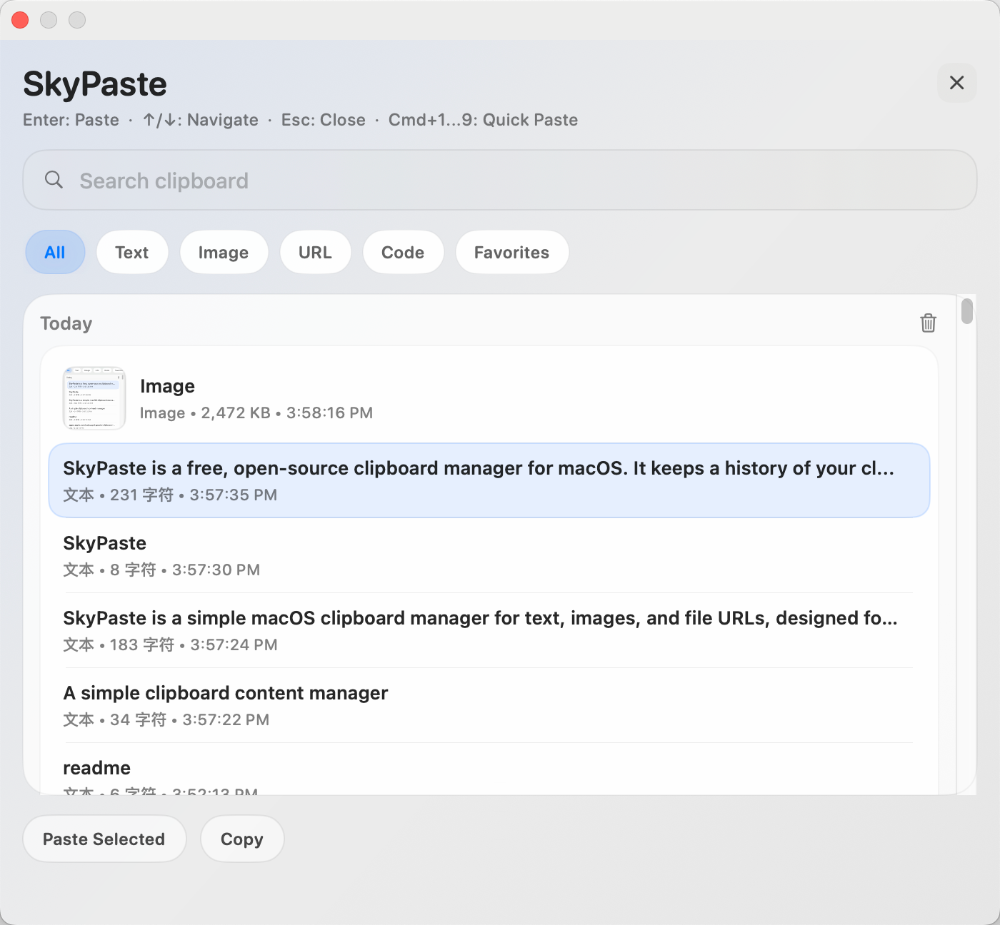
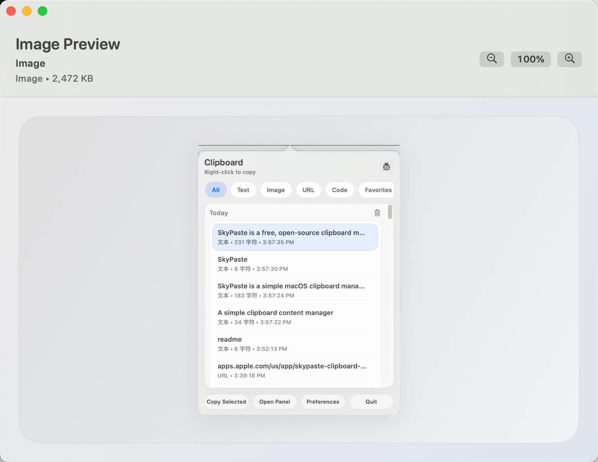
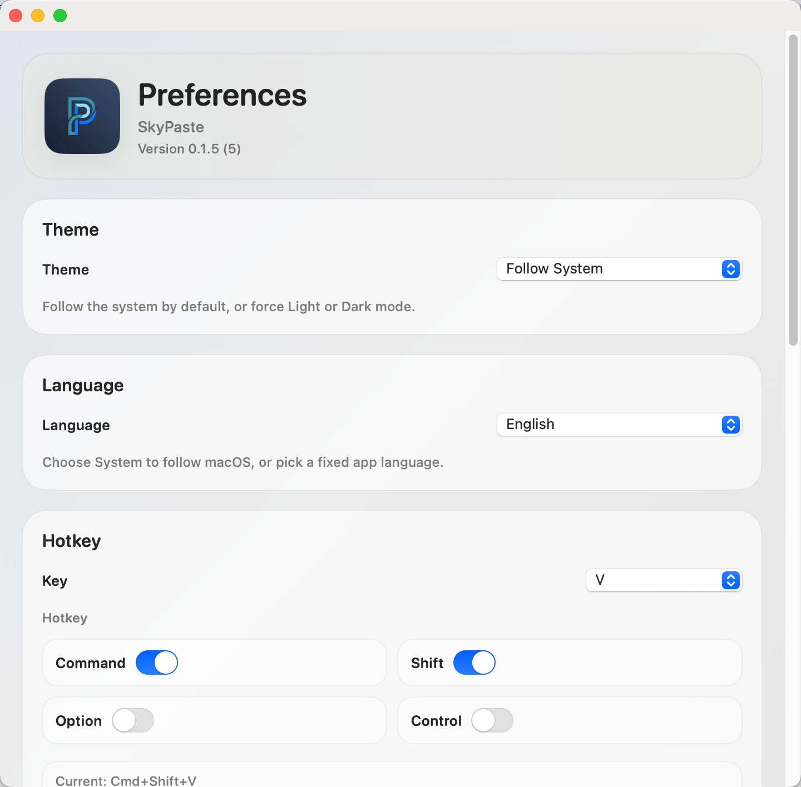

# SkyPaste — Clipboard Manager for macOS & Windows

<p align="center">
  
</p>

<p align="center">
  <strong>A lightweight clipboard history manager for Mac and Windows.</strong><br>
  Save, search, preview, organize, and sync copied text, links, images, files, folders, code, and email addresses.
</p>

<p align="center">
  <a href="README.zh-CN.md">中文</a> | English
</p>

<p align="center">
  <a href="https://apps.apple.com/us/app/skypaste-clipboard-manager/id6760884520?mt=12">Mac App Store</a> ·
  <a href="https://github.com/skyzizhu/SkyPaste/releases/latest">Windows Releases (x64 / x86 / installer)</a>
</p>

SkyPaste records clipboard history, keeps content searchable, groups items by type, supports quick access from the menu bar (macOS) or system tray (Windows), and syncs clipboard text across devices over the local network — including **Mac ↔ Windows ↔ phone**.

## Downloads

| Platform | Package | Notes |
|---|---|---|
| macOS | [Mac App Store](https://apps.apple.com/us/app/skypaste-clipboard-manager/id6760884520?mt=12) · [SkyPaste-macOS.zip](https://github.com/skyzizhu/SkyPaste/releases/latest) | macOS 13+ |
| Windows 10/11 (64-bit) | `SkyPaste-windows-portable.zip` or `SkyPaste-Setup-*.exe` from [Releases](https://github.com/skyzizhu/SkyPaste/releases/latest) | Recommended |
| Windows 10 (32-bit) | `SkyPaste-windows-x86-portable.zip` from [Releases](https://github.com/skyzizhu/SkyPaste/releases/latest) | Legacy portable |

## Features (both platforms)

- Clipboard history for text, links, images, files, folders, code, and email addresses, with source-app badges and day-based groups.
- Filters: All / Text / Image / Files / Folders / Code / URL / Email / Favorites — reorderable, order persisted.
- Powerful search: case-insensitive substring matching, `type:` / `source:` tokens, `fav`, `today`, `yesterday`, plus **pinyin-initial search** (`jtgj` → 截图工具) on Windows.
- Quick access: menu-bar popover (macOS) / tray popover (Windows).
- Global hotkey (default ⌘⇧V on macOS, Ctrl+Shift+V on Windows), paste-back to the previous app, quick-copy shortcuts.
- Image preview with zoom, pan, pen annotation, and full-resolution PNG export.
- File/folder details with contents listing and an image-file dual view.
- Statistics: copy trends, category breakdown, and source-app stats across five time ranges.
- Favorites that survive history trimming, batch operations, delete-day with confirmation.
- Privacy content filtering (password managers, OTP codes, bank cards via Luhn, API tokens/JWT/private keys) and per-app ignore lists.
- Appearance: follow system / light / dark. Six UI languages: English, 简体中文, 繁體中文, 日本語, 한국어, Français.
- Local SQLite storage with automatic corruption recovery.

### Sync

- **macOS ↔ macOS**: iCloud (CloudKit) text sync, plus Universal Clipboard receive from iPhone.
- **macOS ↔ Windows ↔ phone**: optional **LAN sync** (token-protected local HTTP + UDP discovery; nothing leaves your network). Phones push via iOS Shortcuts / Android HTTP — see the [Windows README](SkyPasteWindows/README.md) for step-by-step pairing.

> Note: your computer's LAN IP may change (DHCP). SkyPaste detects the change, refreshes the pairing QR in Preferences and notifies you; consider a DHCP static reservation for the desktop on your router for a permanent fix.

## Screenshots

### Menu Bar Clipboard History (macOS)



### Main Clipboard Panel (macOS)



### Preferences (macOS)



## Local Storage

- macOS: `~/Library/Application Support/SkyPaste/history.sqlite`
- Windows: `%APPDATA%\SkyPaste\history.sqlite`

Data stays local by default. iCloud and LAN sync are optional and off by default.

## Building

| Platform | Requirements | Command |
|---|---|---|
| macOS | Xcode 16+ | `open skypaste.xcodeproj` → Run |
| Windows / cross-build | .NET 8 SDK | `cd SkyPasteWindows && dotnet build SkyPaste.sln && dotnet test tests/SkyPaste.Tests/SkyPaste.Tests.csproj` |

Windows publish (self-contained single-file):

```bash
cd SkyPasteWindows
dotnet publish src/SkyPaste/SkyPaste.csproj -c Release -r win-x64 --self-contained true -p:PublishSingleFile=true -o publish
```

CI builds and tests every push on `windows-latest`; tag releases additionally produce an Inno Setup installer and attach all packages to the GitHub Release.

## Repository Layout

```
skypaste/            macOS app (Swift/SwiftUI, App Store)
SkyPasteWindows/     Windows app (WPF + .NET 8) — see its README for details
docs/                privacy policy, release checklists, screenshots
website/             landing page
```

## Permissions

- macOS: paste-back may request Accessibility; App Sandbox with iCloud + local network.
- Windows: paste-back uses SendInput; LAN sync asks for firewall permission once (local networks only).

## License

[MIT](LICENSE)
