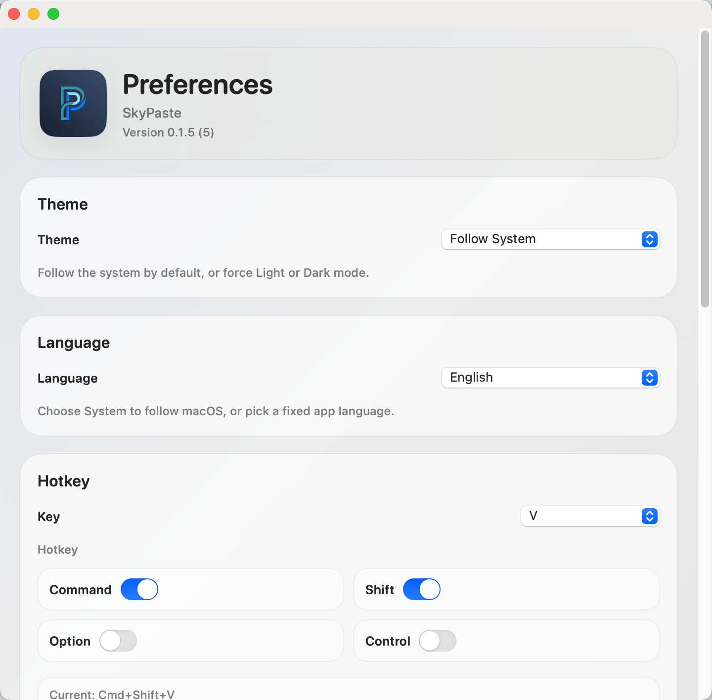

# SkyPaste — macOS 与 Windows 双平台剪贴板管理器

<p align="center">
  
</p>

<p align="center">
  <strong>轻量的 Mac / Windows 剪贴板历史管理器。</strong><br>
  保存、搜索、预览、分类管理你复制的文本、链接、图片、文件、目录、代码与邮箱地址，并支持局域网跨设备同步。
</p>

<p align="center">
  中文 | <a href="README.md">English</a>
</p>

<p align="center">
  <a href="https://apps.apple.com/us/app/skypaste-clipboard-manager/id6760884520?mt=12">Mac App Store</a> ·
  <a href="https://github.com/skyzizhu/SkyPaste/releases/latest">Windows 下载（x64 / x86 / 安装器）</a>
</p>

## 下载

| 平台 | 安装方式 | 说明 |
|---|---|---|
| macOS 13+ | [Mac App Store](https://apps.apple.com/us/app/skypaste-clipboard-manager/id6760884520?mt=12) 或 Releases 中的 `SkyPaste-macOS.zip` | 上架版本 |
| Windows 10/11（64 位） | Releases 中的 `SkyPaste-windows-portable.zip`（便携）或 `SkyPaste-Setup-*.exe`（安装器） | 推荐 |
| Windows 10（32 位） | Releases 中的 `SkyPaste-windows-x86-portable.zip` | 老机器兼容 |

## Windows 版功能速览

剪贴板历史（文本/图片/文件/文件夹/URL/邮箱/代码）、9 个可重排筛选器、搜索语法 + 拼音首字母搜索、全局热键（默认 Ctrl+Shift+V）、粘贴回原应用、托盘弹出层、图片标注导出、文件详情、统计洞察、批量操作、隐私过滤、深浅主题、6 语言界面，以及与 Mac / 手机互通的**局域网同步**。

→ 完整说明与构建方法见 [SkyPasteWindows/README.md](SkyPasteWindows/README.md)。

## 同步方式

- **Mac ↔ Mac**：iCloud（CloudKit）文本同步；可接收 iPhone 通用剪贴板
- **Mac ↔ Windows ↔ 手机**：可选**局域网同步**（令牌保护的本地 HTTP + UDP 发现，数据不出内网）；手机端通过 iOS 快捷指令 / Android HTTP 推送，配对教程见 [Windows README](SkyPasteWindows/README.md)

## 仓库结构

```
skypaste/            macOS 应用（Swift / SwiftUI，App Store 上架）
SkyPasteWindows/     Windows 应用（WPF + .NET 8），详见其 README
docs/                隐私政策、发布清单、截图
website/             官网
```

---

# SkyPaste macOS 版详细说明（原有内容）

## 搜索关键词

macOS 剪贴板管理器、剪贴板历史、剪贴板搜索、剪贴板同步、iCloud 剪贴板、菜单栏剪贴板工具、复制粘贴工具、粘贴管理器、图片剪贴板、文件剪贴板、目录剪贴板、URL 历史、邮箱剪贴板、Mac 效率工具。

## 最新更新

- 新增剪贴板统计，支持五种时间范围下的复制趋势、类型分布和来源应用统计。
- 图片文件详情可切换到交互式图片预览，支持缩放、拖出和划线标注。
- 修复选中项复制问题，并优化唤醒或显示器变化后的面板刷新。
- 在偏好设置的应用推荐中加入文排。

## 截图

### 菜单栏剪贴板历史


### 主面板


### 偏好设置



### 概览


## 功能特性

- 记录文本、链接、图片、文件、目录、代码和邮箱地址等剪贴板历史。
- 菜单栏弹窗快速查看和复制历史内容。
- 主面板支持搜索、分类筛选、来源应用筛选和按天分组。
- 分类支持：全部、文本、图片、文件、目录、代码、URL、邮箱、收藏。
- 邮箱识别，支持独立邮箱分类和发送邮件操作。
- URL 识别，支持浏览器打开。
- 文件和目录识别，支持详情预览、另存为、复制路径、在 Finder 中显示和打开。
- 支持将图片、文件、目录从列表直接拖拽到访达和其他应用。
- 支持通过 macOS 系统分享面板分享文本、链接、图片、文件和目录。
- 图片预览支持缩放和拖动查看。
- 图片文件详情可在文件信息和交互式图片预览间切换。
- 剪贴板统计展示复制趋势、类型分布和来源应用数量。
- 详情页展示来源应用，并支持复制、分享、收藏和对应类型的快捷操作。
- 收藏内容不会因为普通历史上限被清理，除非用户主动取消收藏。
- 支持批量选择、批量删除和批量收藏。
- 本地复制内容支持显示来源应用标识。
- 支持 iCloud 同步 SkyPaste 剪贴板内容。
- 支持同一 Apple 账户下 iPhone 到 Mac 的复制内容同步。
- 支持隐私内容过滤开关，尽量忽略敏感剪贴板文本。
- 支持按应用名称或 bundle ID 忽略指定应用。
- 支持自定义全局快捷键。
- 支持 `Cmd+C`、`Enter`、`Cmd+1...9` 等快捷操作。
- 支持跟随系统、浅色模式和深色模式。
- 内置多语言：英文、简体中文、繁体中文、日语、韩语、法语。
- 本地 SQLite 持久化存储。
- 图片历史做了内存优化，列表懒加载缩略图，复制时按需恢复原图。

## 本地数据位置

SkyPaste 使用本地 SQLite 数据库存储剪贴板历史：

```text
~/Library/Application Support/SkyPaste/history.sqlite
```

数据默认保存在本机。iCloud 同步为可选功能，可在偏好设置中开启。

## 在 Xcode 中打开

SkyPaste 使用 `skypaste.xcodeproj` 作为主工程。

```text
open skypaste.xcodeproj
```

可以通过 `Product -> Run` 运行，或通过 `Product -> Archive` 打包。

如需提交 App Store，请使用 Xcode 归档流程和 App Store Connect。

## 发布与上架文档

- 发布清单：[docs/RELEASING.md](docs/RELEASING.md)
- App Store 清单：[docs/APP_STORE.md](docs/APP_STORE.md)
- 元数据清单：[docs/APP_STORE_CHECKLIST.md](docs/APP_STORE_CHECKLIST.md)
- 隐私政策模板：[docs/PRIVACY_POLICY.md](docs/PRIVACY_POLICY.md)

## 系统权限

如果需要支持自动粘贴回前台应用，macOS 可能会请求辅助功能权限：

```text
系统设置 -> 隐私与安全性 -> 辅助功能
```

请勾选打包后的 SkyPaste App，或开发运行时使用的终端/Xcode。

## 协议

[MIT](LICENSE)
