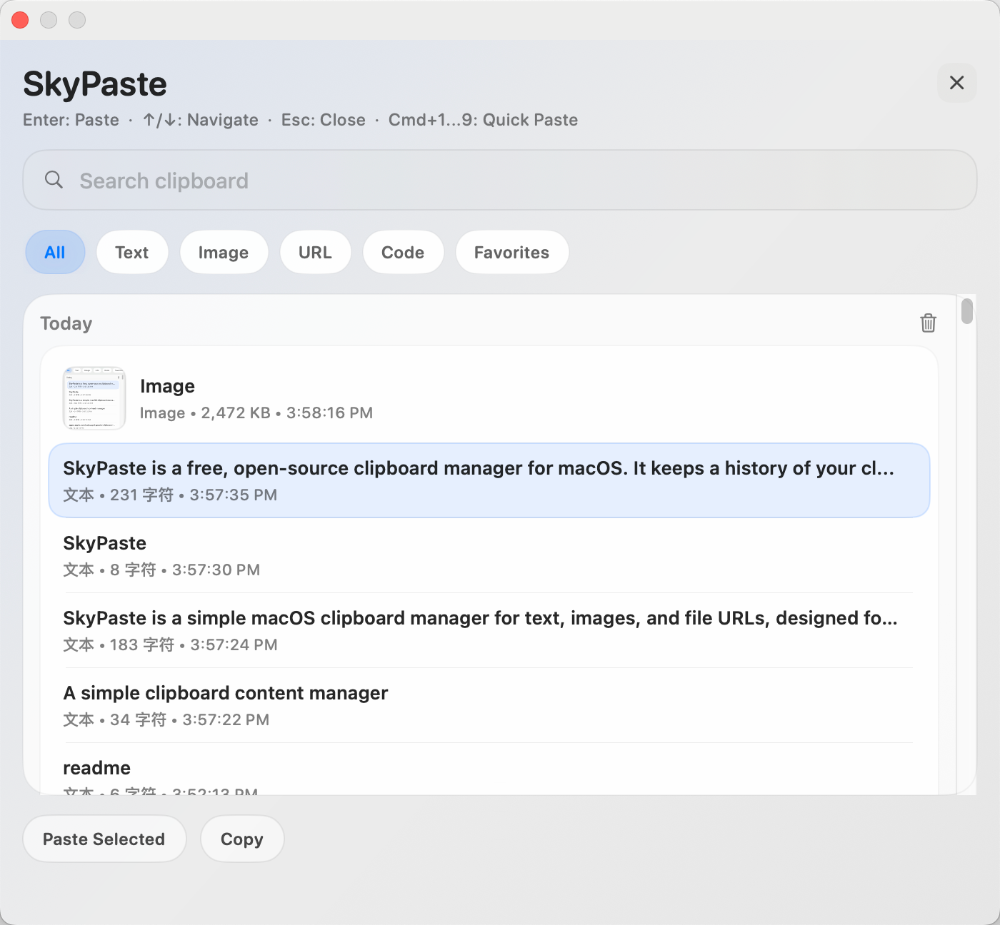
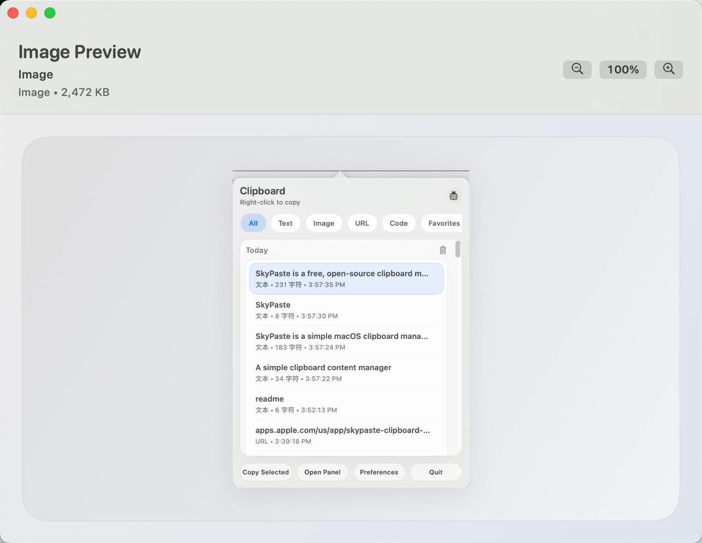
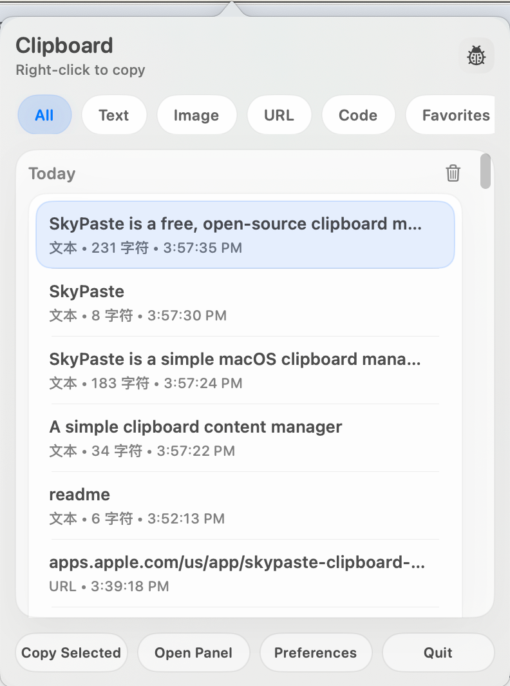

# SkyPaste — macOS 与 Windows 双平台剪贴板管理器

<p align="center">
  
</p>

<p align="center">
  <strong>轻量的 Mac / Windows 剪贴板历史管理器。</strong><br>
  保存、搜索、预览、分类管理你复制的文本、链接、图片、文件、目录、代码与邮箱地址，并支持局域网跨设备同步。
</p>

<p align="center">
  中文 | <a href="README.md">English</a>
</p>

<p align="center">
  <a href="https://apps.apple.com/us/app/skypaste-clipboard-manager/id6760884520?mt=12">Mac App Store</a> ·
  <a href="https://github.com/skyzizhu/SkyPaste/releases/latest">Windows 下载（x64 / x86 / 安装器）</a>
</p>

SkyPaste 会记录剪贴板历史，让内容始终可搜索、按类型分组，并支持菜单栏（macOS）或系统托盘（Windows）快速访问，还可以通过局域网在设备间同步剪贴板文本——包括 **Mac ↔ Windows ↔ 手机**。

## 下载

| 平台 | 安装方式 | 说明 |
|---|---|---|
| macOS 13+ | [Mac App Store](https://apps.apple.com/us/app/skypaste-clipboard-manager/id6760884520?mt=12) 或 Releases 中的 `SkyPaste-macOS.zip` | 上架版本 |
| Windows 10/11（64 位） | Releases 中的 `SkyPaste-windows-portable.zip`（便携）或 `SkyPaste-Setup-*.exe`（安装器） | 推荐 |
| Windows 10（32 位） | Releases 中的 `SkyPaste-windows-x86-portable.zip` | 老机器兼容 |

## 功能特性（双平台）

- 剪贴板历史：文本、链接、图片、文件、目录、代码、邮箱地址，带来源应用标识与按天分组。
- 分类筛选：全部 / 文本 / 图片 / 文件 / 目录 / 代码 / URL / 邮箱 / 收藏，支持拖拽排序并持久化。
- 强大的搜索：大小写不敏感子串匹配、`type:` / `source:` / `fav` / `today` 等搜索语法，Windows 端还支持**拼音首字母搜索**（输入 `jtgj` 命中"截图工具"）。
- 快速访问：菜单栏弹窗（macOS）/ 托盘弹出层（Windows）。
- 全局快捷键（macOS 默认 ⌘⇧V，Windows 默认 Ctrl+Shift+V）、粘贴回原应用、`Cmd/Ctrl+1...9` 快捷复制。
- 图片预览：缩放平移、画笔标注、按原始分辨率导出 PNG。
- 文件/目录详情：内容列表、图片文件双视图、缺失路径提示。
- 剪贴板统计：复制趋势、类型分布、来源应用统计（五种时间范围）。
- 收藏不受历史上限清理；批量选择/删除/收藏；删除当天记录带确认。
- 隐私内容过滤（密码管理器、验证码、银行卡号 Luhn 校验、API Token/JWT/私钥）与忽略应用列表。
- 外观：跟随系统 / 浅色 / 深色；六语言界面：英文、简体中文、繁体中文、日语、韩语、法语。
- 本地 SQLite 存储，损坏自动备份恢复。

### 同步方式

- **Mac ↔ Mac**：iCloud（CloudKit）文本同步；可接收 iPhone 通用剪贴板。
- **Mac ↔ Windows ↔ 手机**：可选**局域网同步**（令牌保护的本地 HTTP + UDP 发现，数据不出内网）；手机端通过 iOS 快捷指令 / Android HTTP 推送，配对教程见 [Windows README](SkyPasteWindows/README.md)。

> 提示：电脑的局域网 IP 可能被路由器重新分配（DHCP）。SkyPaste 会自动检测 IP 变化并刷新设置页二维码、弹窗提醒重新扫码；建议在路由器管理页把电脑的 IP 绑定为静态（DHCP 静态租约），一劳永逸。。

## 截图（macOS）

### 菜单栏剪贴板历史



### 主面板



### 偏好设置


### 概览



## 本地数据位置

| 平台 | 路径 |
|---|---|
| macOS | `~/Library/Application Support/SkyPaste/history.sqlite` |
| Windows | `%APPDATA%\SkyPaste\history.sqlite` |

数据默认保存在本机。iCloud 同步与局域网同步均为可选功能，默认关闭。

## 构建

| 平台 | 环境要求 | 方式 |
|---|---|---|
| macOS | Xcode 16+ | `open skypaste.xcodeproj` → Run / Archive |
| Windows（或跨平台编译） | .NET 8 SDK | `cd SkyPasteWindows && dotnet build SkyPaste.sln && dotnet test tests/SkyPaste.Tests/SkyPaste.Tests.csproj` |

Windows 发布（自包含单文件 exe）：

```bash
cd SkyPasteWindows
dotnet publish src/SkyPaste/SkyPaste.csproj -c Release -r win-x64 --self-contained true -p:PublishSingleFile=true -o publish
```

CI（GitHub Actions）在每次推送时自动于 `windows-latest` 构建 + 测试；打 tag 发布 Release 时会额外生成 Inno Setup 安装器，并将全部安装包附加到 Release 页面。

## 仓库结构

```
skypaste/            macOS 应用（Swift / SwiftUI，App Store 上架）
SkyPasteWindows/     Windows 应用（WPF + .NET 8），详见其 README
docs/                隐私政策、发布清单、截图
website/             官网
```

## 系统权限

### macOS

粘贴回前台应用可能需要辅助功能权限（`系统设置 -> 隐私与安全性 -> 辅助功能`）。App Sandbox 含 iCloud 与本地网络权限。

### Windows

粘贴回通过 SendInput 实现；首次开启局域网同步时会出现防火墙询问（仅限本地网络），选择允许即可。

## 发布与上架文档

- 发布清单：[docs/RELEASING.md](docs/RELEASING.md)
- App Store 清单：[docs/APP_STORE.md](docs/APP_STORE.md)
- 元数据清单：[docs/APP_STORE_CHECKLIST.md](docs/APP_STORE_CHECKLIST.md)
- 隐私政策模板：[docs/PRIVACY_POLICY.md](docs/PRIVACY_POLICY.md)
- Windows：打 tag 后创建 GitHub Release，CI 自动附加 x64 / x86 便携包与安装器

## 协议

[MIT](LICENSE)
